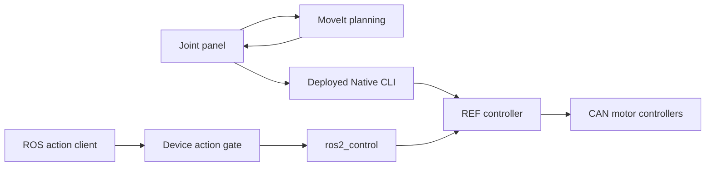

[English](README.md) | [简体中文](README_zh.md)

# Dummy ROS 2

ROS 2 integration for a six-axis Dummy robotic arm, with MoveIt motion planning,
a joint-control panel, model-conversion tools, and device-backed control interfaces.
The workspace targets ROS 2 Jazzy and separates planning, simulation, and hardware execution.

## Demo

https://github.com/user-attachments/assets/d9df87e6-6015-4944-a043-6c12fd92b136

[Full video (1080p MP4)](docs/media/dummy_demo.mp4) · [Smaller video (720p MP4)](docs/media/dummy_demo_github.mp4)

**Model data:** a clone includes the 23 detailed STEP-derived asset files and the
MINIF08 runtime model, distributed by the maintainer under Apache-2.0. No separate
mesh download is needed for the detailed visualization, panel, MoveIt model, or
geometry tests. The source STEP is needed only when regenerating CAD-derived assets.
See [model assets](docs/model-assets.md) for file identities and licensing.
Seven legacy STL files retain their original GPL-3.0 license.

Project code is licensed under [Apache-2.0](LICENSE), with third-party exceptions
listed in [NOTICE](NOTICE) and [LICENSES](LICENSES/README.md).

## Features

- Six-axis joint controls, target previews, and sampled trajectory playback.
- MoveIt planning with scene obstacles, collision checks, and REST planning regressions.
- Separate software-panel, Gazebo, software-in-the-loop, and real-device backends.
- ROS action and ros2_control integration with explicit device state and motion checks.
- Documented CAD conversion, protocol interfaces, and offline test fixtures.



The panel uses MoveIt to plan; execution goes through its selected backend.
The ROS action route has its own lifecycle and authorization checks. A successful
planning response is separate from a device accepting a command or completing motion.
Only one process should own a given device serial port.

## Workspace layout

| Package or directory | Purpose |
| --- | --- |
| `src/dummy-ros2_description` | Robot description, bundled meshes, and model resources |
| `src/dummy_moveit_config` | MoveIt configuration, planning launches, and model tests |
| `src/dummy_bringup` | Panel, backend configuration, and simulation/hardware launches |
| `src/dummy_ros_control` | Transport, hardware plugins, and guarded trajectory control |
| `src/dummy_motion_client` | Device management, bootstrap, and public action interfaces |
| `contracts` | Protocol definitions, generated codecs, profiles, and versioned test data |
| `scripts` | Build helpers, offline checks, model conversion, and integration tools |
| `docs` | Operation, architecture, model-conversion, and test documentation |

## Getting started

Use an environment with ROS 2 Jazzy, colcon, rosdep, MoveIt, ros2_control, RViz,
Xacro, PyQt5, and the dependencies declared by the packages. Gazebo launches also
need `ros_gz_sim`, `ros_gz_bridge`, and `gz_ros2_control`. Use the system ROS Python
interpreter (`/usr/bin/python3`) or a virtual environment with system packages.

```bash
git clone https://github.com/KaminDeng/dummy_ros2.git
cd dummy_ros2
source /opt/ros/jazzy/setup.bash
# Initialize rosdep first if it has not been configured on this machine.
rosdep install --from-paths src --ignore-src -r -y
```

The [runtime model assets](docs/model-assets.md) are included in the clone.
Build the model, MoveIt configuration, and bringup packages:

```bash
bash scripts/build_manual_panel.sh
source /opt/ros/jazzy/setup.bash
source install_panel_guide/local_setup.bash
ROS_DOMAIN_ID=84 ros2 launch dummy_bringup manual_joint_panel.launch.py backend:=simulator
```

This helper writes `build_panel_guide/`, `install_panel_guide/`, and `log_panel_guide/`
and configures `BUILD_TESTING=OFF`. It builds the panel packages; it does not run tests.
The software backend uses no USB connection and is distinct from Gazebo physics.
For zsh, use the corresponding `setup.zsh` and `local_setup.zsh` files.

The panel starts its planning launch by default. Set `moveit:=false` when using a
separately launched planner so that the same ROS domain has one planning service provider.

## Hardware deployment

The panel loads its deployment from
`${XDG_DATA_HOME:-$HOME/.local/share}/dummy_ros/manual_panel/current/panel-config.json`.
Create it from an explicitly selected, compatible Native executable, firmware image,
and identity document:

```bash
ros2 run dummy_bringup deploy_manual_panel.py \
  --native /path/to/dummy_joint_cli \
  --firmware /path/to/dpsdk_firmware.bin \
  --identity /path/to/identity.json
ros2 launch dummy_bringup manual_joint_panel.launch.py backend:=real
```

The deployment utility copies local artifacts and updates a local symlink; it does
not flash firmware or connect to a motor. The checked-in panel configuration is a
deployment template with example device identifiers. Select your own serial endpoint
and client identity during deployment.

State observation, reference confirmation, control recovery, planning, and execution
are separate steps. Closing a process is separate from confirmed stop and disable.
Use the [operation guide](docs/dummy/ros-runbook.md) for the required sequence.

Joint messages use radians and radians/second. The panel generally displays degrees.
Axis arrays use indices 0–5 for Joint1–Joint6; the low six mask bits select those axes.

## Full control workspace

`dummy_ros_control` and `dummy_motion_client` need a compatible DPSDK source checkout
and a separately exported PIC Host SDK. They are not bundled with this repository.
The build verifies the source and library hashes and the required 651-byte message /
18000-byte storage role. An arbitrary SDK installation is not interchangeable.

From a compatible DPSDK checkout, use its
`applications/dummy_ref_control/host/sdk_export.cmake` export path. The complete
build commands and installation arguments are in the [Chinese setup guide](README_zh.md)
and [operation guide](docs/dummy/ros-runbook.md).

After a complete build and sourcing its installation:

```bash
ros2 launch dummy_bringup gazebo_6dof.launch.py gui:=true rviz:=true
```

Gazebo uses its simulation clock. SIL uses a local protocol peer. Real-device
launches require matching deployment inputs and device authorization; these
backends are separate from the panel's software simulator.

## Tests

Geometry tests use the bundled meshes and require the pinned Python dependencies:

```bash
/usr/bin/python3 -m venv --system-site-packages /tmp/dummy-ros-tests
/tmp/dummy-ros-tests/bin/python -m pip install \
  -r src/dummy_moveit_config/test/requirements-geometry.txt
/tmp/dummy-ros-tests/bin/python -m pytest src/dummy_moveit_config/test -q
```

For a complete, configured control workspace:

```bash
colcon --log-base log_dummy test --build-base build_dummy --install-base install_dummy
colcon --log-base log_dummy test-result --test-result-base build_dummy --all --verbose
```

Some integration tests also require the matching DPSDK software peer. A missing
external input is not a successful test result. Use test labels and documentation
to choose unit, component, simulation, or device validation deliberately.

REST and obstacle planning checks use a dedicated ROS domain and one MoveIt instance:

```bash
# Terminal 1: planning only
ROS_DOMAIN_ID=187 ros2 launch dummy_bringup manual_moveit_planning.launch.py backend:=simulator
# Terminal 2: source the same installation first
/usr/bin/python3 scripts/dummy/verify_rest_planning.py \
  --domain-id 187 --output /tmp/dummy-rest-planning.json
```

This script plans and checks sampled states; it does not execute a device trajectory.
The collision geometry and scene-owner checks are described in
[REST planning](docs/dummy/rest-planning.md) and [scene obstacles](docs/dummy/cylinder-obstacles.md).

## Documentation

- [Complete source reading handbook (中文)](docs/dummy/source-reading-guide.html): guided feature routes, an offline source reader, file-by-file notes, and local reading progress for this workspace and the DPSDK application.
- [Operation guide](docs/dummy/ros-runbook.md), including duplicate MoveIt diagnosis and shutdown.
- [Robot model and conversion](docs/dummy/process-reading-guide.md).
- [Coordinate frames](docs/dummy/ground-origin.md) and [collision clearance](docs/dummy/collision-clearance.md).
- [Trajectory execution](docs/dummy/moveit-path-execution.md).
- [Versioned contract data](docs/dummy/contracts-data-reading/README.md).
- [Generated codecs](docs/dummy/generated-codecs/README.md).
- [Current contracts](contracts/README.md); historical wire 2.4 decoding resources live in `compatibility/wire2_4/`.

## Contributing and license

Report problems and propose improvements through
[GitHub Issues](https://github.com/KaminDeng/dummy_ros2/issues).
See [CONTRIBUTING.md](CONTRIBUTING.md) for development and test guidance.

Project code uses the [Apache License 2.0](LICENSE). Retain the licenses and attribution
of third-party sources and legacy model files; see [NOTICE](NOTICE) and
[LICENSES](LICENSES/README.md). The seven legacy STL files retain GPL-3.0; the
23 STEP-derived asset files and MINIF08 model are distributed under Apache-2.0.
