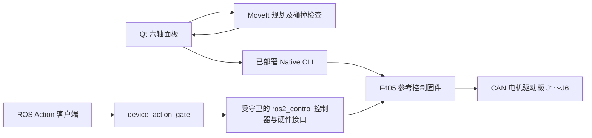

[English](README.md) | [简体中文](README_zh.md)

# Dummy 六轴机械臂 ROS 2 工作区

## Demo 演示

https://github.com/user-attachments/assets/d9df87e6-6015-4944-a043-6c12fd92b136

[观看完整演示（1080p MP4）](docs/media/dummy_demo.mp4) · [轻量版（720p MP4）](docs/media/dummy_demo_github.mp4)

本仓库提供 Dummy 六轴机械臂的 ROS 2 集成：MoveIt 规划、交互面板、模型转换工具，以及
基于设备反馈与事务检查的控制链路。

**模型资源：** 克隆已包含运行所需的完整模型：23份 STEP 派生资源及 MINIF08 模型，
由维护者按 Apache-2.0 分发。面板可视化、MoveIt 和几何回归无需另行下载或准备网格；
源 STEP 仅在重新生成 CAD 派生资源时需要。文件身份与许可见[模型资源说明](docs/model-assets.md)。
七份旧版 STL 继续保留原 GPL-3.0 许可，不由根 Apache-2.0 替换。

自有代码采用 [Apache-2.0](LICENSE)；第三方代码与模型的来源和许可见 [NOTICE](NOTICE)
及 [LICENSES](LICENSES/README.md)。

首次阅读建议先构建并启动**纯软件面板**，理解实际姿态、目标虚影和规划轨迹的区别，
再按所选后端阅读控制与部署接口。面板模拟器、Gazebo 和 SIL 是三种不同环境。

## 软件如何连接机械臂

工作区提供两条控制入口，不能把二者的授权和连接状态混用：



面板的 MoveIt 服务只计算路径，`allow_trajectory_execution` 为 false；操作者确认执行后，
面板才把通过检查的采样轨迹交给 Native。ROS Action 路径由 gate 与控制插件协作，
不能用面板的“已恢复控制”代替其 bootstrap/permit 状态。两条路径应分别使用自己的
完整部署配置；同一个 USB 串口同时只能有一个控制进程拥有。

命令被网络队列接纳、管理请求返回 Pending、CAN 帧实际 SENT、电机反馈到位、
运动最终完成和失能释放确认是不同阶段。实际姿态来自反馈，目标虚影走独立的
`/target_joint_states` 与 `target_preview/` TF，不写回真实关节状态。

## 五个 ROS 包与阅读入口

[全源码阅读指南HTML](docs/dummy/source-reading-guide.html)提供适合新手的功能阅读顺序，
把ROS与DPSDK应用放在同一条往返链路中讲解，再按模块补全2138份文件。
页面内含离线源码、函数/字段定位、逐文件导读、自测与本地阅读记录；打开页面不启动ROS或设备。

| 包 | 作用 | 建议先读 |
| --- | --- | --- |
| `dummy-ros2_description` | 完整 STEP 的彩色视觉、碰撞资源与六轴关节链 | [共享 Xacro](src/dummy-ros2_description/urdf/dummy-ros2.xacro) |
| `dummy_moveit_config` | SRDF、关节规划配置、Gazebo/MoveIt 启动与模型回归 | [SRDF](src/dummy_moveit_config/config/dummy-ros2.srdf)、[模型测试](src/dummy_moveit_config/test) |
| `dummy_bringup` | 面板、配置解析、只读规划服务、场景与不同后端的 launch | [面板启动](src/dummy_bringup/launch/manual_joint_panel.launch.py)、[面板主程序](src/dummy_bringup/scripts/manual_joint_panel.py) |
| `dummy_ros_control` | 设备传输、状态/指令桥、受守卫轨迹控制器及硬件插件 | [构建与依赖锁](src/dummy_ros_control/CMakeLists.txt)、[接口头](src/dummy_ros_control/include) |
| `dummy_motion_client` | 管理事务、bootstrap、permit、公开 Action 入口与目标记录 | [实现目录](src/dummy_motion_client/src)、[接口头](src/dummy_motion_client/include) |

其他目录：

- [contracts](contracts/README.md)：保留当前V2正式合同及仍被工具引用的离线候选；历史2.4仅留必要解码/回归资源，位于 `compatibility/wire2_4/`。
- [scripts/dummy](scripts/dummy)：离线构建、预检、证据拼接、模型工具及独立规划回归。
- [docs/dummy](docs/dummy)：运行说明、模型变更及按阶段保存的验证记录。
- [模型资源逐文件说明](docs/dummy/mesh-reading-guide.md)：35 个网格、材质和严格 JSON
  文件的用途、单位、生成依据及历史摘要的判读方法；几何原件保持原字节。
- [包布局与缓存说明](docs/dummy/package-layout-reading-guide.md)：包元数据、空资源标记、
  历史 Python 字节码和 RViz 窗口状态的用途，以及各类文件的注释格式。
- [冻结合同与证据逐项说明](docs/dummy/contracts-data-reading/README.md)：保留原件字节，解释字段、单位、版本、SHA及历史验收边界。
- [生成codec阅读说明](docs/dummy/generated-codecs/README.md)：当前V2代码生成产物保持原身份，按真实符号阅读。
- [激活校验器说明](docs/dummy/activation-identity-reading/README.md)：完整参数、停止预算与结构校验边界，校验通过不等于允许实机运动。
- `build_*`、`install_*`、`log_*`：本机构建、安装和日志输出。修改与阅读以 `src/` 为主；
  `--symlink-install` 也不代表所有已运行进程会自动重新加载资源。

## 环境与依赖

当前入口面向 ROS 2 **Jazzy**，使用系统 `/usr/bin/python3`。需要 colcon、ament、
MoveIt、ros2_control、RViz、Xacro，以及面板使用的 PyQt5/rclpy；Gazebo 环境另外需要
`ros_gz_sim`、`ros_gz_bridge`、`gz_ros2_control`。各包的 `package.xml` 与 CMake
是依赖声明入口，不要仅依据历史报告中的已安装版本推断本机依赖齐全。

确认当前终端使用了正确环境：

```bash
source /opt/ros/jazzy/setup.bash
command -v ros2 colcon
/usr/bin/python3 -c 'import rclpy, xacro; from PyQt5 import QtWidgets'
ros2 pkg prefix moveit_ros_move_group
ros2 pkg prefix dummy_bringup  # 构建并 source 本工作区后再检查这一项
```

使用 zsh 时，对应 source 文件为 `setup.zsh` / `local_setup.zsh`。
避免把其他旧工作区的安装目录混入 underlay。面板构建脚本会清理相关路径变量后，
只 source 系统 Jazzy；全量工作区构建还需要下面说明的同版 DPSDK Host SDK。

## 开始使用：纯软件面板

先取得源码并安装依赖；[运行模型资源](docs/model-assets.md)已随克隆提供：

```bash
git clone https://github.com/KaminDeng/dummy_ros2.git
cd dummy_ros2
source /opt/ros/jazzy/setup.bash
# rosdep 首次使用时需先按 ROS 官方说明初始化。
rosdep install --from-paths src --ignore-src -r -y
```

随后在本仓库根目录运行：

```bash
bash scripts/build_manual_panel.sh
source /opt/ros/jazzy/setup.bash
source install_panel_guide/local_setup.bash
ROS_DOMAIN_ID=84 ros2 launch dummy_bringup manual_joint_panel.launch.py backend:=simulator
```

该脚本只构建模型、MoveIt 配置、bringup 三个包，输出分别是
`build_panel_guide/`、`install_panel_guide/`、`log_panel_guide/`。它传入
`BUILD_TESTING=OFF`，因此“构建成功”不等于已运行测试。模拟器不打开 USB，
也不运行 Gazebo 物理仿真，可用于认识关节页、规划页、目标预览和交互流程。

`moveit:=false` 可只启动关节面板；默认 true 会同时启动本面板使用的唯一规划节点。
若另行启动 `manual_moveit_planning.launch.py`，面板应使用 `moveit:=false`，
防止同一 ROS 域出现两套 `/check_state_validity` 和 `/plan_kinematic_path` 服务。

## 真机面板：使用明确部署的产物

真机默认配置位于 `${XDG_DATA_HOME:-$HOME/.local/share}/dummy_ros/manual_panel/current/panel-config.json`。
它应由 [deploy_manual_panel.py](src/dummy_bringup/scripts/deploy_manual_panel.py) 生成，
绑定选定的 Native 可执行文件、固件镜像、身份摘要与解码器。该工具只是离线复制和
切换 `current` 软链接，**不烧录固件、不连接电机**。

```bash
# 将示例路径替换为同一批已经核对的实际产物；identity 提供
# contract_sha256、model_sha256、profile_sha256。
ros2 run dummy_bringup deploy_manual_panel.py \
  --native /absolute/selected/dummy_joint_cli \
  --firmware /absolute/selected/dpsdk_firmware.bin \
  --identity /absolute/selected/identity.json

ros2 launch dummy_bringup manual_joint_panel.launch.py backend:=real
```

仓库内的 `manual_joint_panel.json` 是带 `deployment_required` 的模板，不能直接当作
真机部署配置。启动后先只读显示；当前配置的人工双限位确认、退工作 REST、恢复控制、
规划和执行均有各自的显式步骤。断连、进程退出或窗口关闭本身不能代替设备侧失能确认。
界面报告未确认停止时，要查看相应设备状态、原始记录和终态，不能把程序退出码当作
电机已停止的证据。

本机模板的 Home 为 `[0,0,90,0,0,0]` 度，工作 REST 为
`[0,-60,163.97260273972603,0,0,0]` 度；实际配置以部署文件为准。内部消息的
关节角使用 **rad**，角速度为 **rad/s**，界面输入通常是度，电机原始位置可为 **rev**。
`Joint1`～`Joint6` 数组下标为 0～5，轴掩码低六位对应 J1～J6；减速比与方向换算
由模型/设备链路处理，不要在 ROS 输入端重复乘 50。

## 完整 ROS 控制工作区、Gazebo 与 SIL

完整构建涉及 `dummy_ros_control` 和 `dummy_motion_client`，必须显式传入同版、PIC、
651 字节消息 / 18000 字节存储契约的 Host SDK 安装前缀。生产构建使用
`BUILD_TESTING=OFF`，不需要 DPSDK 源码；开启真实 Core/model 离线回归时才需 `DPSDK_ROOT`。
[verify_sdk_inputs.cmake](src/dummy_ros_control/cmake/verify_sdk_inputs.cmake)
会检查安装包的协议、角色及头/库/业务包摘要；Host SDK 导出脚本 `applications/dummy_ref_control/host/sdk_export.cmake`
位于相邻 DPSDK 仓库。前缀是已经正确导出的安装目录，不是任意旧 build 目录。

可先从所选 DPSDK 源码导出这一角色的 SDK。以下三步只做 Host 构建和安装：

```bash
export DPSDK_ROOT=/path/to/dpsdk  # 替换为本机兼容的 DPSDK 源码目录
cmake -S "$DPSDK_ROOT" -B /tmp/dummy-ros-pic-sdk-build \
  -DPRODUCT=posix_dummy_ref_ros_sdk -DCMAKE_BUILD_TYPE=Debug
cmake --build /tmp/dummy-ros-pic-sdk-build --parallel 4 --target dummy_ref_ros_sdk
cmake --install /tmp/dummy-ros-pic-sdk-build \
  --prefix /tmp/dummy-ros-pic-sdk-install --component dummy_ref_ros_sdk
```

随后在本 ROS 仓库构建，把下面两项 SDK 路径中的示例前缀替换为刚导出的
`/tmp/dummy-ros-pic-sdk-install`，或你选定的其他同版安装区：

```bash
source /opt/ros/jazzy/setup.bash
export DPSDK_ROOT=/path/to/dpsdk  # 替换为本机兼容的 DPSDK 源码目录
bash scripts/dummy/build.sh \
  --cmake-args -DPython3_EXECUTABLE=/usr/bin/python3 \
  -DDPSDK_HOST_SDK_PREFIX=/absolute/matching/host-sdk-install \
  -DDPSDKHostSDK_DIR=/absolute/matching/host-sdk-install/lib/cmake/DPSDKHostSDK
source install_dummy/setup.bash
```

脚本先由 `scene.yaml` 生成 Gazebo 世界，再执行全工作区 colcon 构建；遇到 SDK
安装载荷摘要不匹配，应核对实际候选与重新验证记录，不应删除锁或随意复制新摘要。
两项 SDK 路径指向同一安装区：`DPSDK_HOST_SDK_PREFIX` 用于显式身份核验，
`DPSDKHostSDK_DIR` 使下游 Action 包也能解析控制包导出的 SDK 依赖。

协议由 SDK 中的 `DpProtocol` 完整 release 提供，机器人模型/profile 包独立位于
`share/dummy_ref/robot_contract`。运行 `contract_hash` 使用稳定 `wire_contract_sha256`；
完整载荷聚合、profile、工具和 release manifest SHA 分别保留，不能互换。ROS 包版本与
ROS typesupport type hash 属于 ROS 接口层，不能替代设备 wire 身份。冻结 `contracts/`
及 wire2.4 回归原件继续保留，其字节不作为本次 current SDK 的发布身份。

仅构建这两个包可使用显式 `colcon --packages-select dummy_ros_control dummy_motion_client`。
定向 CTest `sdk_input_lock_tests` 检查真实 SDK 缺包、错 Codec/ABI 和载荷篡改；
`current_protocol_release_identity` 检查稳定 wire 与来源分层以及 wrapper 元数据拒绝；
`installed_sdk_source_hidden_consumer` 使用 bubblewrap 在私有 mount 中屏蔽两仓源码，
编译并运行安装消费者、装载真实插件，并在冻结合同不可见时配置生产包。
这些离线检查不会启动 ROS 节点、MoveIt 或物理设备。


| 环境 | 入口 | 实际用途 |
| --- | --- | --- |
| Qt 模拟器 | `manual_joint_panel.launch.py backend:=simulator` | 无 USB 的交互面板反馈模型 |
| Gazebo 六轴 | `gazebo_6dof.launch.py gui:=true rviz:=true` | Gazebo `/clock` 与模拟控制器 |
| 六轴 SIL | `sil_6dof.launch.py endpoint:=tcp/127.0.0.1:17446` | 本机Zenoh、模拟CAN电机模型及设备协议链路；当前peer直接注入提交/发送回调 |
| J1 SIL | `sil_j1.launch.py endpoint:=tcp/127.0.0.1:17447` | 单轴协议/管理链路对照 |
| 真实 ROS 六轴 | `real_6dof.launch.py`，由会话脚本装配参数 | 身份、activation、限值及证据文件全部匹配的设备链路 |

例如完整构建并 source 后运行 Gazebo：

```bash
ros2 launch dummy_bringup gazebo_6dof.launch.py gui:=true rviz:=true
```

SIL 的硬件组件初始保持 inactive，不自动授予 permit 或开始运动；其管理步骤与真实
ROS 六轴的部署参数见 [运行手册](docs/dummy/ros-runbook.md)。手册的 R00～R08、
旧 J1 和 wire-v1 章节是历史阶段记录；当前接口与版本应再对照
[协议目录](contracts/dummy_robot_v2) 和实际 launch 源码。

## 测试与 REST 规划回归

在已 source 系统 ROS 和相应安装区的终端运行。模型几何测试另有经验证的依赖清单：

```bash
/usr/bin/python3 -m venv --system-site-packages /tmp/dummy-ros-tests
/tmp/dummy-ros-tests/bin/python -m pip install \
  -r src/dummy_moveit_config/test/requirements-geometry.txt
/tmp/dummy-ros-tests/bin/python -m pytest src/dummy_moveit_config/test -q
```

完整包测试由 colcon 注册，包含单元、组件及 launch 测试：

```bash
colcon --log-base log_dummy test --build-base build_dummy --install-base install_dummy
colcon --log-base log_dummy test-result --test-result-base build_dummy --all --verbose
```

启动只读 MoveIt 服务后，可以单独核对精确 REST 的双向规划、全部 TOTG/插值采样、
自碰撞与地面接触负例；脚本不打开 USB 或执行轨迹：

```bash
# 终端一：独立域，只运行一套服务
ROS_DOMAIN_ID=187 ros2 launch dummy_bringup manual_moveit_planning.launch.py backend:=simulator
# 终端二：source 相同安装区
/usr/bin/python3 scripts/dummy/verify_rest_planning.py \
  --domain-id 187 --output /tmp/dummy-rest-planning.json
```

REST 曾因 J1 凹支架的整件凸包填实让位空间而被误判自碰撞，现通过分区保守包络修复。
不能以关闭接触对、替换 REST 或移除地面保护解决。重建和验证依据见
[REST 规划说明](docs/dummy/rest-planning.md)、[几何间隙](docs/dummy/collision-clearance.md)。
当前规划通过不等同于执行过实机轨迹；历史报告也只支持它记录的版本与环境。

## 常见问题

| 现象 | 先检查什么 |
| --- | --- |
| `dummy_bringup` 或 `dummy_moveit_config` 找不到 | 确认已构建，再 source 对应 `install_panel_guide` 或 `install_dummy`；检查 `ros2 pkg prefix` 返回路径 |
| 真机提示“需要先部署”或摘要校验失败 | 模板与部署配置是否混用；Native/固件/解码器是否仍属于同一批固定产物 |
| 规划请求偶发返回不同结果或超时 | 同一域是否有重复 MoveIt 服务；面板默认会包含规划 launch |
| 修改 STL/SRDF 后结果没变化 | 安装路径是否指向当前资源，已有 MoveIt 是否仍缓存旧 BVH；重启对应规划进程并重新读参数验证 |
| 实际模型或目标虚影重叠/不动 | `/joint_states`、`/target_joint_states`、各自动态 TF 与 RViz Fixed Frame；仅启动 robot_state_publisher 不会自行产生关节变化 |
| Gazebo 时间不走或动作不完成 | `/clock`、`use_sim_time`、控制器是否加载/激活；软件面板模拟器没有 Gazebo 时钟 |
| Action 显示成功但缺少设备结论 | 继续核对原请求终态、相同 run/session/epoch 的 CAN SENT 和新鲜反馈；Action-only 报告不代替设备证据 |

完整装配与坐标定义可继续阅读 [完整 STEP 模型](docs/dummy/full-step-model.md)、
[根坐标](docs/dummy/ground-origin.md)、[路径执行与连续续接](docs/dummy/moveit-path-execution.md)。

## 参与开发与许可证

问题报告和功能建议请使用 [GitHub Issues](https://github.com/KaminDeng/dummy_ros2/issues)。
提交修改前请阅读[贡献说明](CONTRIBUTING.md)，说明修改目的、验证范围及外部依赖。

自有代码使用 [Apache License 2.0](LICENSE)。保留原版权声明的 MoveIt 示例、ROS 测试及
旧版模型分别按 [NOTICE](NOTICE) 与 [LICENSES](LICENSES/README.md) 所列许可使用；
23份 STEP 派生资源及 MINIF08 模型由维护者按 Apache-2.0 分发；
根许可证不替换七份旧 STL 的 GPL-3.0 或其他第三方原许可。
